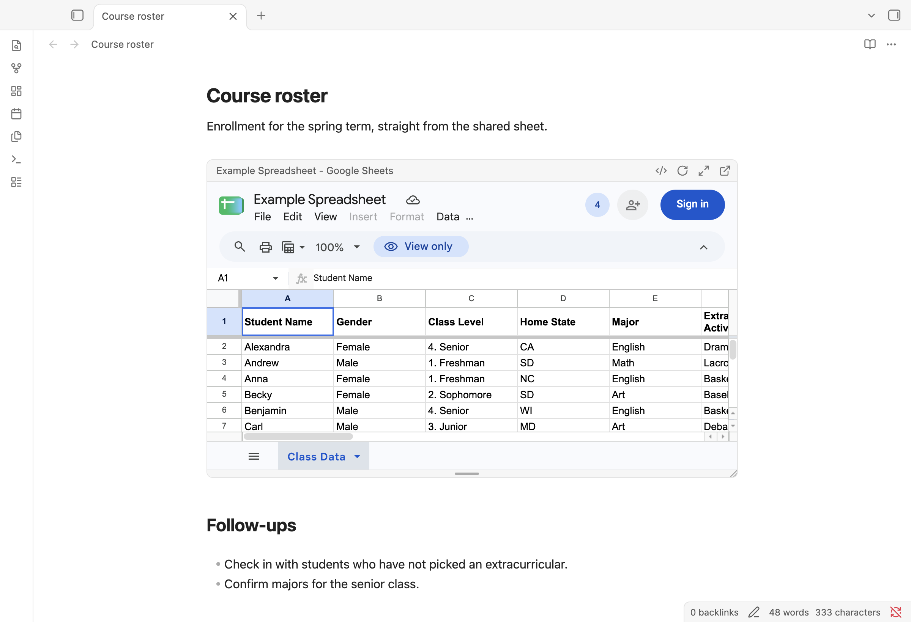

# Embed Google Docs

An Obsidian plugin that shows live Google Docs, Sheets and Slides inside a note.
Paste a sharing link as an embed:

```markdown
![[https://docs.google.com/document/d/1AbC.../edit?usp=sharing]]
```

The document opens in place, fully interactive (scroll, read, edit, comment),
using the Google account you sign in with. Desktop only.



A Google Docs, Sheets or Slides link pasted on an empty line becomes an embed by
itself. Pasted into text, or over selected text, it stays a link.

## Size, mode and resizing

Drag the bar under an embed to change its height, or the corner to change
width and height. The new size is written into the link:

| Link                  | Size                          |
| --------------------- | ----------------------------- |
| `![[link]]`           | full width, default height    |
| `![[link\|600]]`      | full width, 600 px tall       |
| `![[link\|800x600]]`  | 800 px wide, 600 px tall      |

A single number is the **height** (unlike images, where it is the width), since
documents fill the note's width. Dragging the corner back to full width drops
the width again.

The link can also pick how that one document opens, overriding the **Embed
mode** setting: `edit` (the full editor), `minimal` (the editor without menus
and toolbar) or `preview` (read-only). Size and mode go together in any order,
as in `![[link|600 preview]]`, and resizing keeps the mode.

## More room, new files

- The expand button in an embed's header opens the document in a tab of its
  own; Ctrl/Cmd+Alt-click opens it in a split.
- **New document**, **New spreadsheet** and **New presentation** in the
  command palette create the file in your Google Drive and embed it at the
  cursor.

## Signing in

Run **Embed Google Docs: Sign in to Google** from the command palette, or use
the **Sign in** button in the plugin settings, and log in as you would in a
browser. All embeds share that session, and it persists across restarts. The
**Sign in** button Google shows inside an embed works too. The sign-in window
opens in the main Obsidian window; the button in the settings closes them
first.

Obsidian's own web viewer cannot sign in to Google: Obsidian rewrites the
sign-in request headers on the sessions it creates, and Google rejects them.
This plugin keeps its embeds on a separate session (`persist:embed-google-docs`)
that Obsidian leaves alone, and sends Chrome's user agent. If Google ever
refuses the sign-in ("This browser or app may not be secure"), set a different
user agent in the settings, for example a current Firefox one.

## Settings

- **Embed mode**: the full editor, the editor without menus and toolbar, or a
  read-only preview, for links that do not name a mode.
- **Default height**: for links without a size.
- **Embed pasted links**: turn pasted links into embeds, as described above.
- **User agent**: leave empty unless sign-in fails.

## Behavior worth knowing

- Documents show only in the main Obsidian window. In a pop-out window, embeds
  and document tabs offer **Open in browser** instead: Electron, which Obsidian
  runs on, crashes when a web page inside a pop-out window takes focus. The
  sign-in and new-file windows always open in the main window.
- Each embed is a full browser page. Embeds load only when they scroll into
  view, and Obsidian unloads them again when they scroll far away, so they
  reload when you come back.
- In live preview, the link text shows while the cursor is on it, like
  Obsidian's own embeds. The `</>` button in the embed's header jumps there.
- Resizing in reading view rewrites the note, which re-renders and reloads the
  embed. Resizing in live preview does not reload it.
- Links clicked inside a document open the way Obsidian opens external links.
- Links from **File → Share → Publish to the web** embed as they are, read-only,
  and work without signing in. The embed mode does not apply to them.
- Links with `/u/1/` (or another number) open as that signed-in account, when
  you are signed in to more than one.
- Embeds inside code blocks are left as text.

## Network use and accounts

- **Google account**: viewing private documents and editing need a Google
  account. Public documents open without one.
- **Network**: embeds, document tabs and the sign-in and new-file windows load
  pages from Google (`docs.google.com`, `accounts.google.com` and whatever those
  pages load).
  The plugin contacts no other service, collects no data and sends nothing
  anywhere itself.
- **Session data**: the Google sign-in cookies are stored by Obsidian's
  Electron runtime in the `persist:embed-google-docs` session, outside your
  vault. **Sign out of Google** clears the login.

## Install

In Obsidian, open Settings → Community plugins → Browse, search for
**Embed Google Docs**, then install and enable it.

To install by hand, download `main.js`, `manifest.json` and `styles.css` from
the [latest release](https://github.com/Jeff1995/embed-google-docs/releases/latest)
into `<vault>/.obsidian/plugins/embed-google-docs/`, then enable
**Embed Google Docs** under Settings → Community plugins.

## Development

```sh
npm install
npm run build   # or `npm run dev` to rebuild on every change
```

To release, set the new version in `manifest.json` and `package.json`, commit,
and push a tag with that version (`git tag 0.1.2 && git push origin 0.1.2`).
GitHub Actions builds the plugin, attests the files and publishes the release.

## License

[MIT](LICENSE)
